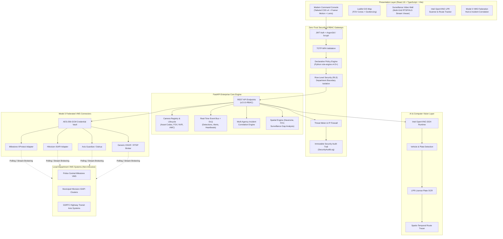

# 🛡️ Enterprise CCTV Registry, Federation & Analytics Platform

[](https://fastapi.tiangolo.com)
[](https://react.dev)
[](https://www.typescriptlang.org)
[](https://vitejs.dev)
[](https://www.intel.com/content/www/us/en/developer/tools/openvino-toolkit/overview.html)
[](https://github.com)
[](https://github.com/zeroSteiner/rule-engine)

A mission-critical, enterprise-grade unified CCTV registry, Model 3 federation broker, and geospatial AI analytics system built for managing **80,000+ CCTV nodes across 26 government departments and sovereign jurisdictions**.

The platform provides centralized metadata governance, non-intrusive stream brokering across multi-vendor VMS networks (Milestone, Hikvision ISAPI, Dahua, Axis, ONVIF), real-time cross-agency incident correlation, vehicle route reconstruction (ANPR), and an immutable cybersecurity audit log with 8-tier Zero-Trust role isolation.

---

## 📑 Table of Contents

- [Core Architectural Highlights](#-core-architectural-highlights)
- [System Architecture](#-system-architecture)
- [8-Tier Authority Role Hierarchy](#-8-tier-authority-role-hierarchy)
- [Interactive Features](#-interactive-features)
- [Demo Seed Credentials](#-demo-seed-credentials)
- [Project Structure](#-project-structure)
- [Prerequisites & Requirements](#-prerequisites--requirements)
- [Quick Start Guide](#-quick-start-guide)
  - [1. Backend Setup](#1-backend-setup)
  - [2. Frontend Setup](#2-frontend-setup)
  - [3. Running Mock VMS Servers (Optional)](#3-running-mock-vms-servers-optional)
- [Verification & Automated Test Suite](#-verification--automated-test-suite)
- [Key API Endpoints](#-key-api-endpoints)
- [Security, Compliance & Governance Rules](#-security-compliance--governance-rules)

---

## 🌟 Core Architectural Highlights

1. **Model 3 Federated Surveillance Architecture**:
   - Central registry federates **metadata and event telemetry**, keeping actual video streams localized and accessed strictly on-demand.
   - Non-intrusive VMS adapters for **Milestone XProtect (REST/SOAP)**, **Hikvision ISAPI**, **Axis Guardian**, **Dahua**, and **Generic ONVIF/RTSP**.
   - AES-256-GCM encrypted external credential vault for VMS tokens, passwords, and ONVIF WS-Security digests.

2. **Declarative Rule Engine Standard (Zero-Trust)**:
   - Business policies, field mutations, and access control decision trees are compiled declaratively with Python `rule-engine` rather than hardcoded `if-elif` chains.
   - Rigorous Row-Level Security (RLS) restricts departmental operators strictly to their department's jurisdiction (`department_id`).

3. **Intel OpenVINO™ Accelerated AI Engine**:
   - Integrated License Plate Recognition (LPR) deep-learning pipeline with vehicle detection, plate localization, and character recognition.
   - ANPR spatio-temporal route reconstruction mapping vehicle trajectories with speed estimates, time-series waypoints, and watchlist hits.

4. **GIS Spatial Intelligence**:
   - Geodesic math (Haversine formulas) for camera proximity, inter-camera distances, and blind-spot gap analysis.
   - Dynamic Field-of-View (FOV) cone geometry calculated in real-time from azimuth, viewing angle, and coverage radius.

5. **Cross-Department Incident Correlation & Event Bus**:
   - Pub/Sub real-time event bus with Dead-Letter Queue (DLQ) tracking detections, camera statuses, and alerts.
   - Correlation engine flags multi-agency suspect plate sightings, cross-jurisdiction highway pursuits, and dispatches automated cross-department workflow tasks.

6. **Cyber Defense & Threat Engine**:
   - Real-time threat meter calculating brute-force login anomalies, unauthorized route attempts, and API rate spikes.
   - Dynamic IP firewall with one-click IP banning and automated mitigation.
   - Cryptographic Argon2id/bcrypt password hashing and Time-based One-Time Password (TOTP) MFA for privileged personnel.
   - Immutable security audit ledger (`SecurityAuditLog`) logging every query, login, and mutation.

---

## 🏛️ System Architecture



---

## 👥 8-Tier Authority Role Hierarchy

The platform implements strict least-privilege role boundaries across 8 recognized state authorities:

| # | Role Key | Role Title | Key Privileges & Scope | Strict Boundaries |
|---|---|---|---|---|
| 1 | `SUPER_ADMIN` | State Command Director General | Full system-wide administration across all 26 departments, platform configurations, user approvals, cross-agency reports. | Must verify TOTP MFA on every login. |
| 2 | `SECURITY_ADMIN` | Cybersecurity & Compliance Director | Threat incident mitigation, IP firewall blocklists, system health telemetry, immutable audit log inspection. | Cannot mutate camera hardware specs or alter VMS credentials. |
| 3 | `DEPARTMENT_ADMIN` | Departmental Nodal Administrator | Full lifecycle management of cameras, local VMS platforms, and local operators within their assigned `department_id`. | Strictly restricted from viewing or altering assets of other departments. |
| 4 | `AI_ANALYST` | Intelligence & Analytics Specialist | ANPR vehicle trajectory reconstruction, suspect watchlists, Intel OpenVINO LPR scanning, spatial gap analysis. | Cannot modify camera hardware records or approve user registrations. |
| 5 | `GIS_OPERATOR` | Spatial & Geospatial Specialist | Edits spatial telemetry (lat, lon, azimuth, FOV angles, coverage radius, ward boundaries), blind spot mapping. | Forbidden from editing camera IP addresses, VMS credentials, or watchlists. |
| 6 | `MAINTENANCE_OFFICER` | Operations & Facilities Lead | Manages SLA tickets, schedules repairs, assigns technicians, transitions camera maintenance lifecycle states. | Cannot view live video feeds, RTSP stream URLs, or ANPR plate hits. |
| 7 | `TECHNICIAN` | Field Maintenance Engineer | Views assigned repair work orders, updates resolution summaries, uploads proof-of-work photos and repair costs. | Strictly forbidden from viewing live streams, ANPR queries, or camera registries. |
| 8 | `OPERATOR` | Surveillance Control Room Operator | Live video wall monitoring and alert acknowledgement strictly within their home department. | Read-only stream access; cannot mutate cameras, tickets, or users. |

---

## 💻 Interactive Features

- **Interactive GIS Command Map**: Pan and zoom across Gujarat's districts, view camera markers color-coded by online health, and inspect interactive FOV coverage cones.
- **Dynamic Surveillance Video Wall**: Responsive 2x2, 3x3, and 4x4 matrix layouts supporting live stream viewing, PTZ controls, and simulated RTSP feeds.
- **Vehicle Route Reconstruction (ANPR)**: Search suspect license plates (`GJ-01-AB-1234`) to render animated chronological waypoint routes on the map with vehicle snapshots and speed estimates.
- **Intel OpenVINO™ LPR Scanner**: Upload vehicle imagery to run hardware-accelerated license plate detection and text OCR directly against the local OpenVINO model.
- **Model 3 VMS Federation Hub**: Manage external VMS platform connections, trigger real-time metadata synchronizations, inspect cross-system event streams, and review correlated multi-agency incidents.
- **Surveillance Gap Analysis**: Spatial heatmaps identifying high-crime or dense transit corridors lacking camera coverage.
- **Maintenance & SLA Ticketing**: Complete ticket lifecycle management with technician assignment, vendor tracking, and SLA countdowns.
- **User Approval Pipeline**: Enterprise self-registration with administrative approval workflow for newly registered government personnel.

---

## 🔑 Demo Seed Credentials

Pre-configured seed accounts across all 8 authorities for testing and demonstration:

| Role | Email | Password | TOTP MFA Code | Department |
|---|---|---|---|---|
| **SUPER_ADMIN** | `superadmin@platform.gov.in` | `admin123` | `123456` | All 26 Departments (State Command) |
| **SECURITY_ADMIN** | `securityadmin@platform.gov.in` | `sec123` | Direct / N/A | State Cybersecurity & Compliance |
| **DEPARTMENT_ADMIN** | `deptadmin.police@platform.gov.in` | `police123` | Direct / N/A | Police & Law Enforcement (DEPT-01) |
| **DEPARTMENT_ADMIN** | `deptadmin.transit@platform.gov.in` | `transit123` | Direct / N/A | GSRTC Highway Transit (DEPT-02) |
| **AI_ANALYST** | `aianalyst@platform.gov.in` | `ai123` | Direct / N/A | Central Intelligence & Analytics |
| **GIS_OPERATOR** | `gisoperator@platform.gov.in` | `gis123` | Direct / N/A | Spatial Planning & Surveying |
| **MAINTENANCE_OFFICER**| `maintenance@platform.gov.in` | `maint123` | Direct / N/A | Infrastructure & Facilities |
| **TECHNICIAN** | `technician.field@platform.gov.in` | `tech123` | Direct / N/A | Field Technical Services |
| **OPERATOR** | `operator.traffic@platform.gov.in` | `op123` | Direct / N/A | Municipal Traffic Command |

---

## 📁 Project Structure

```text
.
├── backend/                        # Enterprise FastAPI Backend Engine
│   ├── main.py                     # Primary FastAPI application with 8-authority RBAC
│   ├── models.py                   # Dataclasses & Enums (Users, Cameras, VMS, Incidents)
│   ├── auth.py                     # JWT token generation, Argon2id/bcrypt & TOTP MFA
│   ├── permissions.py              # Zero-Trust RBAC registry & RLS boundary checks
│   ├── security_engine.py          # Threat meter scoring & IP firewall blocklist
│   ├── crypto_vault.py             # AES-256-GCM external VMS secrets encryption
│   ├── ai_engine.py                # ANPR route reconstruction & spatial gap analysis
│   ├── spatial.py                  # Geodesic Haversine math & FOV cone geometry
│   ├── stream_broker.py            # RTSP/HLS stream brokering logic
│   └── seed_data.py                # Gujarat government seed data generator (500+ nodes)
│
├── frontend/                       # Modern React 19 Frontend Console
│   ├── src/
│   │   ├── components/             # React UI Components
│   │   │   ├── Dashboard.tsx       # State Command Overview
│   │   │   ├── GisMap.tsx          # Leaflet GIS Map with FOV Cones
│   │   │   ├── VideoWall.tsx       # Live Multi-Grid Surveillance
│   │   │   ├── AnprTracker.tsx     # Vehicle Trajectory Reconstruction
│   │   │   ├── IntelLprScanner.tsx # Intel OpenVINO LPR Interface
│   │   │   ├── VmsFederation.tsx   # Model 3 Federation & Event Correlation
│   │   │   ├── CameraRegistry.tsx  # Camera Inventory & CSV Bulk Importer
│   │   │   ├── Maintenance.tsx     # SLA Tickets & Work Orders
│   │   │   ├── SecurityDashboard.tsx # Cybersecurity & Firewall Admin
│   │   │   ├── AdminApprovals.tsx  # User Registration Approval Pipeline
│   │   │   └── LoginPage.tsx       # MFA-enabled Login Screen
│   │   ├── context/                # Authentication & Theme Context
│   │   ├── types.ts                # TypeScript interfaces
│   │   └── App.tsx                 # Client routing & ProtectedRoute guards
│   ├── package.json                # Frontend dependencies (React 19, Tailwind v4, Vite)
│   └── vite.config.ts              # Vite server & API proxy config
│
├── app/                            # Modular Service Extensions
│   ├── core/                       # In-Memory Event Bus & DLQ
│   ├── routers/                    # AI & Supabase sub-routers
│   └── services/
│       ├── adapters/base.py        # Pluggable VMS Adapter Framework (Milestone, ISAPI)
│       ├── correlation_engine.py   # Spatio-Temporal Cross-VMS Correlation
│       ├── lpr/                    # Intel OpenVINO Inference Pipeline
│       └── supabase_service.py     # Optional Supabase Cloud Sync
│
├── scripts/
│   ├── mock_vms_servers.py         # Simulated Milestone & Hikvision VMS REST servers
│   └── supabase_schema.sql         # Production PostgreSQL / Supabase SQL schema
│
├── tests/                          # Automated Pytest Suite
│   ├── security/                   # Zero-Trust privilege escalation tests
│   ├── test_lpr_integration.py     # OpenVINO LPR pipeline tests
│   └── test_vms_federation_workflow.py # Model 3 Federation event tests
│
├── requirements.txt                # Python backend dependencies
├── run_check.py                    # Standalone system self-check script
├── test_all_8_authorities_limits.py# Comprehensive 8-authority permission matrix test
└── test_security_privilege_escalation.py # Privilege escalation attack test
```

---

## ⚙️ Prerequisites & Requirements

- **Python**: Version 3.10, 3.11, or 3.12
- **Node.js**: Version 18.0.0 or higher (with `npm`)
- **Git** installed
- **OS**: Windows, Linux, or macOS

---

## 🚀 Quick Start Guide

### 1. Backend Setup

1. **Clone the repository**:
   ```bash
   git clone https://github.com/your-username/enterprise-cctv-federation-platform.git
   cd enterprise-cctv-federation-platform
   ```

2. **Create and activate a Python virtual environment**:
   ```bash
   # Windows (PowerShell)
   python -m venv venv
   .\venv\Scripts\Activate.ps1

   # Linux / macOS
   python3 -m venv venv
   source venv/bin/activate
   ```

3. **Install Python dependencies**:
   ```bash
   pip install --upgrade pip
   pip install -r requirements.txt
   ```

4. **Configure environment variables (Optional)**:
   ```bash
   # Copy template if using external Supabase sync
   cp .env.example .env
   ```

5. **Start the FastAPI backend server**:
   ```bash
   uvicorn backend.main:app --host 127.0.0.1 --port 8000 --reload
   ```
   The backend API will be live at `http://127.0.0.1:8000`.  
   Interactive API documentation (Swagger) is available at `http://127.0.0.1:8000/docs`.

---

### 2. Frontend Setup

1. **Navigate to the frontend directory**:
   ```bash
   cd frontend
   ```

2. **Install Node dependencies**:
   ```bash
   npm install
   ```

3. **Launch the Vite development server**:
   ```bash
   npm run dev
   ```
   Open your browser and navigate to `http://localhost:5173`.  
   Log in using any of the [Demo Seed Credentials](#-demo-seed-credentials).

---

### 3. Running Mock VMS Servers (Optional)

To test the **Model 3 VMS Federation** with live HTTP endpoints, launch the simulated external Milestone and Hikvision services:

```bash
# In a separate terminal with venv activated
python scripts/mock_vms_servers.py
```
- Milestone REST VMS mock runs on `http://127.0.0.1:8081`
- Hikvision ISAPI VMS mock runs on `http://127.0.0.1:8082`

Navigate to the **VMS Federation** tab in the UI and click **Sync Platforms** to pull external cameras and process cross-system telemetry events in real time.

---

## 🧪 Verification & Automated Test Suite

The project includes an exhaustive automated testing suite covering authentication, RBAC boundaries, LPR inference, and event correlation.

### Run Instant Self-Check
```bash
python run_check.py
```
*Validates seed accounts, TOTP MFA flow, cybersecurity threat score calculation, and ANPR route reconstruction.*

### Run 8-Authority Permission Boundary Matrix
Ensure the backend server is running on `http://127.0.0.1:8000`, then execute:
```bash
python test_all_8_authorities_limits.py
```
*Performs exhaustive cross-testing across all 8 roles verifying that lower tiers (such as TECHNICIAN, GIS_OPERATOR, OPERATOR) receive HTTP 403 Forbidden on restricted endpoints.*

### Run Privilege Escalation Attack Tests
```bash
python test_security_privilege_escalation.py
```
*Simulates hostile vertical and horizontal privilege escalation attempts (e.g. tampering with department IDs, forging user roles, direct health telemetry modification).*

### Run Pytest Suite
```bash
pytest tests/ -v
```

---

## 📡 Key API Endpoints

| Category | Method | Endpoint | Description | Role Required |
|---|---|---|---|---|
| **Auth** | `POST` | `/api/v1/auth/login` | Authenticate user; returns JWT or temp token if MFA is required | Public |
| **Auth** | `POST` | `/api/v1/auth/verify-mfa` | Validate TOTP code and issue final access token | Public |
| **Auth** | `POST` | `/api/v1/auth/register` | Self-register new user (enters pending approval state) | Public |
| **Registry** | `GET` | `/api/cameras` | List cameras with pagination, status, and department filters | All Roles |
| **Registry** | `POST` | `/api/cameras` | Register a new camera node | `SUPER_ADMIN`, `DEPARTMENT_ADMIN` |
| **Registry** | `POST` | `/api/cameras/bulk-csv` | Bulk register cameras via CSV file upload | `SUPER_ADMIN`, `DEPARTMENT_ADMIN` |
| **Spatial** | `PATCH` | `/api/cameras/{id}/spatial` | Update GIS coordinates, azimuth, and FOV parameters | `GIS_OPERATOR`, `SUPER_ADMIN`, `DEPARTMENT_ADMIN` |
| **Spatial** | `GET` | `/api/analysis/gaps` | Calculate spatial blind spots and surveillance deficits | `AI_ANALYST`, `GIS_OPERATOR`, Admins |
| **AI / ANPR**| `GET` | `/api/anpr/route-reconstruction` | Reconstruct vehicle route from plate detections | `AI_ANALYST`, `SUPER_ADMIN` |
| **AI / LPR** | `POST` | `/api/v1/ai/lpr/recognize` | Run Intel OpenVINO vehicle and plate inference | `AI_ANALYST`, `SUPER_ADMIN` |
| **VMS** | `GET` | `/api/v1/vms/platforms` | List registered external VMS platforms | Admins |
| **VMS** | `POST` | `/api/v1/vms/platforms/{id}/sync`| Synchronize external VMS cameras into central registry | `SUPER_ADMIN`, `DEPARTMENT_ADMIN` |
| **VMS** | `GET` | `/api/v1/vms/events/stream` | Stream federated events from event bus | Authorized Personnel |
| **VMS** | `GET` | `/api/v1/vms/correlation/incidents` | Retrieve multi-agency correlated incidents | Authorized Personnel |
| **Security** | `GET` | `/api/v1/security/threat-meter` | Compute system threat score and anomaly levels | `SECURITY_ADMIN`, `SUPER_ADMIN` |
| **Security** | `POST` | `/api/v1/security/block-ip` | Add an IP address to the firewall blocklist | `SECURITY_ADMIN`, `SUPER_ADMIN` |
| **Audits** | `GET` | `/api/v1/security/audit-logs` | Retrieve immutable audit trail records | `SECURITY_ADMIN`, `SUPER_ADMIN` |

---

## 🔒 Security, Compliance & Governance Rules

This codebase strictly adheres to the **Ponytail Architecture & Code Governance Standards**:

1. **Strict Least Privilege & Zero Escalation**: Lower-tier roles (`TECHNICIAN`, `MAINTENANCE_OFFICER`, `OPERATOR`, `GIS_OPERATOR`) cannot touch records outside their designated domain. Live video streams, raw RTSP paths, ANPR searches, and watchlist edits are forbidden for technicians and maintenance officers.
2. **Immutable System Telemetry**: Automated health metrics (`health_status`, `health_score`, `last_ping`, `packet_loss_pct`) are system-generated and cannot be altered by human API requests.
3. **Multi-Tenant Row-Level Isolation (RLS)**: Queries by departmental operators and administrators are strictly filtered by `department_id`. Horizontal privilege escalation via URL tampering is rejected.
4. **Declarative Rule Engine**: Chained `if-elif-else` trees for access policies and filtering are banned in favor of pre-compiled `rule_engine.Rule` instances.
5. **Secrets Governance**: External VMS passwords, tokens, and digest keys are never stored in plaintext and are encrypted using AES-256-GCM.
6. **Immutable Audit Ledger**: Every query, state transition, and login attempt writes a persistent record to `SecurityAuditLog`.

---

## 📄 License & Attribution

This project is developed for enterprise surveillance registry and state security operations.  
All intellectual property and architectural specifications conform to state command governance standards.
